  

<h3>👨‍💻 Sobre mí</h3>

Ingeniero Industrial y profesional en Ciencia de Datos de la <b>Universidad Tecnológica de Bolívar</b>, en Cartagena de Indias, Colombia. Me gusta llevar los datos de punta a punta: desde el sensor o la base de datos hasta el modelo y el dashboard desplegado.

<ul>
  <li>🎧 La música me acompaña en todo: programando, estudiando o simplemente pensando.</li>
  <li>🔍 Soy curioso por naturaleza; si algo funciona, quiero entender por qué.</li>
  <li>🔥 Me apasiona lo que hago y disfruto convertir datos en algo que se pueda ver y usar.</li>
  <li>🌱 Siempre aprendiendo algo nuevo, de un proyecto a la vez.</li>
  <li>💬 Abierto a colaborar, conversar de datos o recomendar buena música.</li>
</ul>

 

  
  
  

 

  
  
  
  
  
  
  
  
  
  
  
  
  
  
  
  
  
  
  
  
  
  
  
  
  
  
  
  
  
  
  
  
  

 

  
  

<h2>Proyectos destacados</h2>

<table>
  <tr>
    <th>Proyecto</th>
    <th>Descripción</th>
    <th>Stack</th>
  </tr>
  <tr>
    <td><a href="https://github.com/Gdearmascasta/CMAPS-RUL">CMAPS-RUL</a></td>
    <td>Predice cuántos ciclos de vida le quedan a un motor de avión antes de fallar, a partir de las lecturas de sus sensores. Usa datos de la NASA (CMAPSS), con análisis exploratorio, limpieza de datos y un modelo de regresión.</td>
    <td><code>Jupyter · Python · Scikit-learn</code></td>
  </tr>
  <tr>
    <td><a href="https://github.com/Gdearmascasta/Vitrina">Vitrina</a></td>
    <td>Página inmersiva para promocionar una experiencia de turismo campesino alrededor de la guama en los Montes de María, Bolívar. Tiene video, paisaje sonoro, mapa interactivo y formulario de reserva (<a href="https://vitrina-phi.vercel.app">demo</a>).</td>
    <td><code>Next.js · TypeScript · Tailwind · Framer Motion</code></td>
  </tr>
  <tr>
    <td><a href="https://github.com/Gdearmascasta/P_BD">P_BD</a></td>
    <td>Sistema tipo SCADA para monitorear temperatura y humedad en tiempo real desde sensores. Guarda las lecturas en una base de datos normalizada y permite consultarlas desde la web con 20 consultas SQL listas para probar (<a href="https://p-bd.onrender.com">demo</a>).</td>
    <td><code>React · FastAPI · PostgreSQL</code></td>
  </tr>
  <tr>
    <td><a href="https://github.com/Gdearmascasta/Sensado_y_modeladoSF">Sensado_y_modeladoSF</a></td>
    <td>Cinco experimentos que conectan física y datos: medir la gravedad siguiendo un objeto en video, analizar el movimiento de un péndulo y clasificar el uso del suelo con imágenes satelitales. Todos se lanzan desde una sola app.</td>
    <td><code>Python · TypeScript · OpenCV · FastAPI</code></td>
  </tr>
  <tr>
    <td><a href="https://github.com/Gdearmascasta/Gestion-de-flota-APP">Gestion-de-flota-APP</a></td>
    <td>App para administrar vehículos y pedidos de reparto. Calcula rutas de entrega más cortas y las muestra en un mapa (<a href="https://gestion-de-flota-app.vercel.app">demo</a>).</td>
    <td><code>React · FastAPI · Leaflet</code></td>
  </tr>
</table>

 

  <picture>
    <source media="(prefers-color-scheme: dark)" srcset="https://raw.githubusercontent.com/Gdearmascasta/Gdearmascasta/output/pacman-contribution-graph-dark.svg" />
    <source media="(prefers-color-scheme: light)" srcset="https://raw.githubusercontent.com/Gdearmascasta/Gdearmascasta/output/pacman-contribution-graph.svg" />
    
  </picture>

